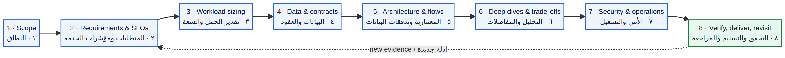
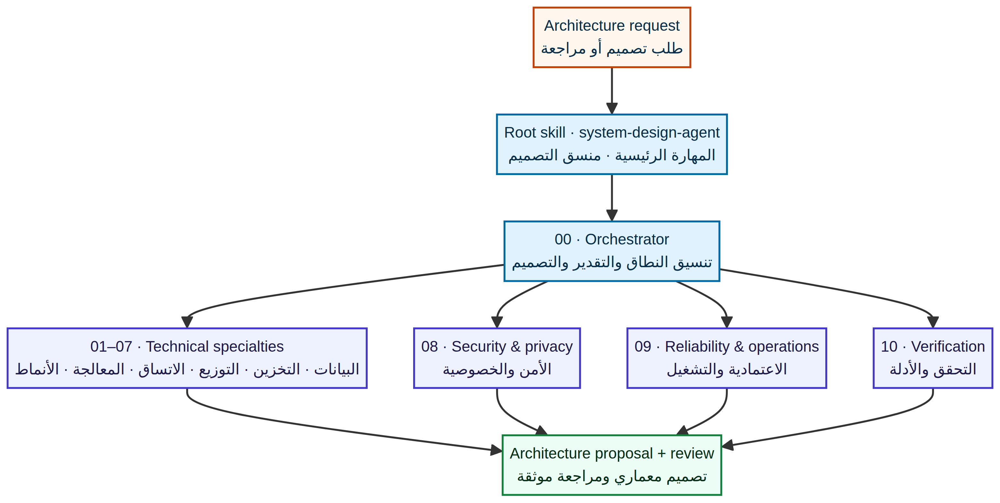

# حزمة مهارة وكيل تصميم الأنظمة

[العربية](README.md) · [English](../README.md)

حزمة محايدة تجاه المورّد وقابلة للنقل بين وكلاء الذكاء الاصطناعي التي تدعم تنسيق المهارات. تجمع مهارة رئيسية وعشر مهارات تخصصية وموجّهًا لاختيارها وأدلة وقوالب وقوائم تحقق ورسومًا توضيحية ثنائية اللغة.

## مخطط سير العمل

يبدأ الوكيل بتحديد النطاق ومتطلبات الجودة، ثم يقدّر الحمل والسعة، وينمذج البيانات والعقود، ويصمم المعمارية والتدفقات، ويدرس المفاضلات، ويراجع الأمن والتشغيل، ثم يتحقق ويسلّم. قد تستدعي أدلة جديدة الرجوع إلى تقديرات أو متطلبات سابقة.

## كيف يستدعي الوكيل المهارات

يبدأ التصميم الشامل بالمهارة الرئيسية والمنسق، ثم يحمّل التخصصات اللازمة. وتُدرج مراجعة الأمن والاعتمادية والتحقق في التصميم الكامل. أما السؤال المحدد فيستدعي التخصص المرتبط به وتبعياته فقط.

## بنية الحزمة

| المسار | الغرض |
|---|---|
| `SKILL.md` | المهارة العربية الرئيسية: متى تُستخدم، وقواعد الجودة، وسير العمل، ومخرجات التصميم |
| `skills/00-system-architect-orchestrator/` | النطاق والمتطلبات وتقدير الحمل وتنسيق التصميم |
| `skills/01-data-models-storage/` | نماذج البيانات والفهارس ومحركات التخزين وملاءمتها للأحمال |
| `skills/02-data-encoding-evolution/` | توافق المخططات والواجهات والأحداث عبر الإصدارات |
| `skills/03-replication-partitioning/` | النسخ والتقسيم والاتساق وإعادة التوازن |
| `skills/04-transactions-consensus-consistency/` | المعاملات والعزل والترتيب والإجماع |
| `skills/05-batch-stream-processing/` | الدفعات والطوابير والسجلات وCDC والتدفقات وإعادة التشغيل |
| `skills/06-infrastructure-primitives/` | محددات المعدل والمعرفات والذاكرة المخبئية ولبنات أخرى |
| `skills/07-product-architecture-blueprints/` | أنماط بنية المنتجات والخدمات الشائعة |
| `skills/08-security-privacy-architecture/` | نمذجة التهديد والهوية والوصول والخصوصية |
| `skills/09-reliability-operations/` | أهداف الخدمة والرصد والحوادث والسعة والنسخ والتعافي |
| `skills/10-architecture-verification/` | تتبع المتطلبات والاختبارات والأدلة ومراجعة التصميم |
| `references/` | الموجّه والقوالب وقائمة التدقيق وسجل القرار وخريطة الفصول |

## التثبيت والاستخدام

إذا كان الوكيل يدعم تنسيق Agent Skills، فأضف **مجلد `ai-skill/` كاملًا** إلى موضع المهارات الذي توثقه المنصة المضيفة. حافظ على بنية الملفات؛ فالنسخة العربية متداخلة في `ar/`، بينما توجد النسخة الإنجليزية في الجذر. تختلف مسارات التثبيت وطريقة التفعيل بين المنتجات؛ لا تفترض أن مسارًا من وكيل معين يعمل في غيره.

إذا لم يدعم الوكيل اكتشاف المهارات تلقائيًا، فضع المجلد في مساحة عمله واستخدم طلبًا مثل:

> استخدم مهارة تصميم الأنظمة. اقرأ `ai-skill/ar/SKILL.md` و`ai-skill/ar/references/skill-router.md`. اتبع سير العمل، وحمّل ملفات التخصص المناسبة، ثم سلّم تصميمًا يوضح الافتراضات والمفاضلات ودلالات الفشل والأمن والعمليات والتحقق والمخاطر المتبقية.

لمهمة محددة، سمِّ ملف التخصص مباشرة، مثل `ai-skill/ar/skills/02-data-encoding-evolution/SKILL.md`. استبدل `ai-skill/ar/` بمسار التثبيت الفعلي إن اختلف.

## الملفات المرجعية

- [المهارة العربية الرئيسية](SKILL.md)
- [موجّه التخصصات](references/skill-router.md)
- [قالب التصميم المعماري](references/architecture-design-template.md)
- [قائمة مراجعة المعمارية](references/architecture-review-checklist.md)
- [سجل القرار المعماري](references/architecture-decision-record.md)
- [خريطة فصول الكتابين](references/chapter-to-skill-crosswalk.md)
- [دليل الحزمة بالإنجليزية](../README.md)

## الفحوص الآلية

يشغّل GitHub Actions فحوص البنية والروابط والتخصصات وتغطية الفصول عند الدفع إلى `main` أو فتح طلب دمج، كما يمكن تشغيلها يدويًا. من جذر المستودع نفّذ `python3 scripts/validate_skills.py`. تتحقق هذه الفحوص من سلامة تنظيم الملفات لا من صحة تصميم نظام بعينه أو أمانه.

## حدود الاستخدام وحقوق المصدر

لا تستطيع أي عملية تصميم ضمان انعدام الأخطاء. تهدف الحزمة إلى تقليل السهو عبر إظهار الافتراضات والتحقق والإبلاغ عن المخاطر المتبقية. ملخصات الفصول مكتوبة بصياغة أصلية وموجزة ولا تتضمن ملفات PDF ولا تحل محل الكتب.
