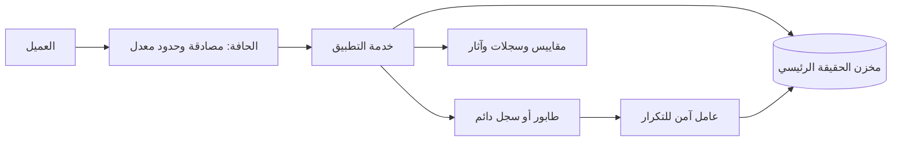

# قالب تصميم معمارية النظام

استخدم هذا القالب للتصاميم المهمة. احذف الأقسام غير المناسبة وعلّم المجهولات؛ لا تختلق إجابات.

## 1. خلاصة التصميم

لخّص المعمارية الموصى بها في فقرة قصيرة، مع سبب الاختيار وأهم مفاضلة.

## 2. المتطلبات والافتراضات

### المتطلبات الوظيفية
- [السلوك المطلوب والاستبعادات الصريحة]

### متطلبات الجودة
- التوافر/هدف الخدمة:
- مئينات زمن الاستجابة:
- المتانة/الحداثة:
- RTO/RPO:
- الأمن/الخصوصية/الامتثال:
- التكلفة والقيود التشغيلية:

### الافتراضات والأسئلة المفتوحة
| البند | القيمة/الافتراض | الثقة | أثر الخطأ |
|---|---|---|---|

## 3. الحمل والسعة

| الكمية | المدخلات والصيغة | التقدير | الوحدة | الثقة |
|---|---|---|---|---|
| متوسط/ذروة QPS | | | طلب/ثانية | |
| نسبة القراءة/الكتابة | | | % | |
| البيانات المخزنة خلال الاحتفاظ | | | بايت | |
| حركة الشبكة/النسخ | | | بايت/ثانية أو بت/ثانية | |
| حجم الذاكرة المخبئية | | | بايت | |
| التزامن الأقصى | | | طلب | |

اعرض الافتراضات وعوامل الذروة والتحميل الإضافي وهامش الأمان/الاستعادة وما إذا كان الرقم مقاسًا أو تقديريًا. تجنب الدقة الزائفة.

## 4. عقود البيانات والواجهات

صف الكيانات ومالكيها وأنماط الوصول الأساسية والثوابت وحدود المعاملات ودورة البيانات والحقول الحساسة والاحتفاظ والحذف ومخططات الواجهات/الأحداث والخمول تجاه التكرار وتقسيم الصفحات والأخطاء والتفويض وفترة التوافق.

## 5. الطوبولوجيا عالية المستوى

استبدل هذا المثال بالمكونات والتدفقات الفعلية. بيّن المسارات المتزامنة وغير المتزامنة وحدود الثقة ومناطق الفشل والنسخ والتدفقات المسماة.

## 6. القرارات المهمة والبدائل

| القرار | الخيار الموصى به | البدائل | ملاءمته | كلفة/مفاضلة الفشل | التحقق |
|---|---|---|---|---|---|

## 7. الصحة ودلالات الفشل

حدّد مصدر الحقيقة والاتساق والترتيب والمعاملات والتعامل مع التكرار والإعادات والقراءات القديمة والفشل الجزئي والحمل الزائد والمفاتيح الساخنة وانقطاع التبعيات وإصلاح البيانات والترحيل والسلوك المتدهور الذي يراه المستخدم.

## 8. الأمن والخصوصية

اسرد الأصول والجهات وحدود الثقة والتهديدات والمصادقة والتفويض وعزل المستأجر والأسرار والتشفير وتدفقات البيانات الحساسة والإساءة والتدقيق والاحتفاظ والحذف والمخاطر المتبقية.

## 9. الاعتمادية والعمليات

عرّف مؤشرات/أهداف الخدمة ولوحات المعلومات والتنبيهات القابلة للتنفيذ وأدلة التشغيل وتحديد المعدل/التخلص من الحمل والنشر والتراجع والتحقق من النسخ والاستعادة والتعافي من الكوارث ومحفزات السعة وملكية العمليات.

## 10. التنفيذ والتطور

رتب العمل في خطوات آمنة. في الترحيل، اذكر مراحل التوسيع/الترحيل/التضييق والملء الخلفي والكتابة أو القراءة المزدوجة عند الحاجة والتحويل والتراجع أو الاسترداد ومقاييس النجاح.

## 11. حالة التحقق

| الادعاء/المتطلب | الدليل أو الاختبار | النتيجة | الفجوة الباقية |
|---|---|---|---|

افصل الاختبارات التي نُفذت عن المقترحة. اذكر المخاطر والافتراضات التي تحتاج إلى تحقق والخطوة التالية الأصغر المفيدة.
