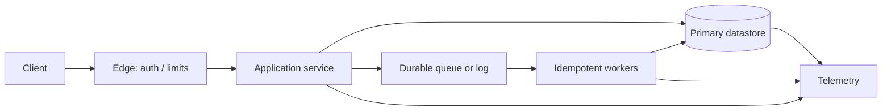

# منسق معماري النظام

## 1. التفويض والمحفزات

استخدم هذه المهارة للتصميم من الصفر (greenfield)، أو إعادة التصميم، أو مراجعة البنية المعمارية، أو خطط التوسّع، أو تحليل الموثوقية، أو اتخاذ قرار تقني كبير. وجّه الأسئلة التقنية الضيقة إلى مهارة المجال المناسبة في هذا المستودع. لا تفرض بنية موزعة على حمل عمل صغير؛ بل فضّل أبسط تصميم يفي بالاحتياجات المقيسة.

استخدم حلقة من أربع مراحل: (1) تحديد النطاق والقياس الكمي، (2) اقتراح تصميم متماسك عالي المستوى وتأكيد افتراضاته، (3) التعمق في المخاطر الحرجة، (4) تحديد العمليات والتطور. قيّم كل خيار من حيث الموثوقية وقابلية التوسع وقابلية الصيانة.

## 2. الاستقبال وتحديد النطاق

حدّد المستخدمين، وحالات الاستخدام الأساسية، والمتطلبات الوظيفية، والاستبعادات، والواجهات، وحساسية البيانات، وقيود الامتثال، وبيئة النشر، والميزانية/القدرة التشغيلية، والأفق الزمني للتسليم. سجّل المجهولات صراحةً. عرّف أهداف مستوى الخدمة (SLOs) القابلة للقياس: التوافر، ومئينات زمن الاستجابة، والمتانة، والحداثة، ووقت الاسترداد (RTO)، ونقطة الاسترداد (RPO)، حيثما ينطبق ذلك.

قِس حمل العمل بحسب العملية والمستأجر: معدل الطلبات المتوسط والذروي، ومزيج القراءة/الكتابة، وأحجام الحمولات، والتزامن، ومدة الاندفاع، والتوزيع الجغرافي، والنمو، والاحتفاظ، وأنماط الوصول. افصل حالة الاستقرار عن ذُرى الحمل الناتجة عن الحملات أو الدفعات. حدّد معنى الصحة لكل عملية (مثلًا: هل القراءات القديمة مقبولة؟ هل الآثار الجانبية المكررة مقبولة؟).

## 3. الحسابات التقريبية السريعة

استخدم وحدات متسقة واذكر كل افتراض. هذه تقديرات من الرتبة الأولى وليست ضمانات للسعة.

- متوسط QPS = requests per day / 86,400؛ وQPS الذروي = متوسط QPS × معامل الذروة (أو يُستخلص من نوافذ الذروة المقيسة).
- QPS للقراءة = إجمالي QPS × نسبة القراءة؛ وQPS للكتابة = إجمالي QPS × نسبة الكتابة.
- التخزين الخام = records/day × average stored bytes × retention days. أضف الفهارس، والنسخ المتماثلة، والبيانات الوصفية، والهامش الاحتياطي لإزالة التجزئة، ونسخ الاحتياط كلًّا على حدة؛ وأبلغ عن التقديرين المنطقي والفعلي.
- معدل الشبكة (بايت/ثانية) = operations/s × average transferred bytes. حوّله إلى بت/ثانية بالضرب في ×8؛ وراعِ حمل البروتوكول الإضافي والنسخ المتماثل/التوزيع إلى عدة وجهات (fan-out).
- مساحة الذاكرة المؤقتة ≈ hot-key count × serialized value size × per-entry overhead. قدّر نسبة الإصابة باستخدام آثار حمل العمل؛ ولا تستنتجها من سعة الذاكرة المؤقتة وحدها.
- الطلبات المتزامنة ≈ arrival rate × mean service time (قانون ليتل، L = λW؛ استخدم وحدات متطابقة واذكر افتراضات الانتظار في الطوابير).
- توافر التبعيات التسلسلية المستقلة يُقارب حاصل ضرب توافرها؛ لكن الاستقلالية غالبًا غير صحيحة، لذا حلّل نطاقات الفشل المشتركة.
- التخزين المتماثل ≈ البيانات المنطقية × عدد النسخ المتماثلة، قبل الفهارس والحمل الإضافي وإزالة التجزئة والنسخ الاحتياطية.

بالنسبة إلى زمن الاستجابة، استخدم قيمًا مقيسة أو منشورة من المورّد للبيئة الفعلية. فكّك زمن الاستجابة من طرف إلى طرف إلى ميزانيات للشبكة، والطابور، والحوسبة، والتخزين، والمصبات اللاحقة. لا تثبت المتوسطات سلوك p95/p99/p999. تجنّب الادعاءات العامة بأرقام زمن الاستجابة دون سياق.

## 4. قواعد اختيار البنية المعمارية

- إذا استطاعت قاعدة بيانات علائقية واحدة تلبية متطلبات حمل العمل وصحة النتائج والاسترداد، فابدأ بها؛ وإلا فحدّد عنق الزجاجة المقيس قبل إضافة التقسيم أو مخازن متخصصة.
- إذا كانت أنماط الوصول مستقرة وكانت القيود/المعاملات العلائقية مهمة، ففضّل النمذجة العلائقية؛ وإلا فقارن نماذج المستندات، والقيمة-المفتاح، والرسوم البيانية، والبحث، والتحليل مقابل استعلامات صريحة.
- إذا كانت القراءات القديمة مقبولة، ففكّر في النسخ المتماثل غير المتزامن؛ وإلا فحدّد دلالات الاتساق المطلوبة وكلفة زمن الاستجابة/التوافر.
- إذا كان حمل العمل كثيف الكتابة وكان الإدخال التسلسلي هو الغالب، فقيّم التخزين القائم على LSM؛ وإلا، إذا كانت القراءات النقطية/ذات النطاق والتحديثات الموضعية المتوقعة هي الغالبة، فقيّم التخزين القائم على B-tree. تحقّق من إزالة التجزئة، وتضخيم الكتابة، والفهارس، والمتانة للمحرك الفعلي.
- إذا كانت المفاتيح مرتبة طبيعيًا وكانت عمليات المسح ذات النطاق هي الغالبة، ففكّر في التقسيم إلى نطاقات مع تخفيف النطاق الساخن؛ وإلا فقد يوزّع التقسيم بالتجزئة الحمل، لكنه يفقد محلية البيانات.
- إذا كان العمل غير متزامن وقابلًا لإعادة المحاولة بطبيعته، فاستخدم طوابير/سجلات متينة مع مستهلكين خاملين تجاه التكرار (idempotent)؛ وإلا فاستخدم الاستدعاءات المتزامنة فقط عندما يحتاج المستدعي إلى نتيجة فورية وتسمح ميزانية زمن الاستجابة لديه بذلك.
- إذا امتدت الصحة عبر خدمات متعددة من دون معاملة موزعة عملية، فنمذج عملية Saga/سير عمل مع تعويض صريح وخمول تجاه التكرار؛ ولا توحِ أبدًا بأن التعويض هو تراجع (rollback).
- إذا تعذّر على العمليات شرح النظام المقترح واختباره واسترداده، فبسّطه أو أضف القدرة التشغيلية قبل الإطلاق.

## 5. سير عمل الإنشاء

### المرحلة 1 — النطاق والعقود

اكتب المتطلبات الوظيفية وغير الوظيفية، والافتراضات، والثوابت، وعقود API، ودلالات الأخطاء، وتقسيم الصفحات، والمصادقة/التفويض، ومفاتيح الخمول تجاه التكرار، وحدود المعدل، وإدارة الإصدارات. حدّد الكيانات والملكية ودورة الحياة. قدّر السعة العادية والذروية.

### المرحلة 2 — نموذج البيانات وحمل العمل

اسرد الاستعلامات وعمليات التغيير؛ واربط كلًّا منها بالفهرسة، واحتياجات الاتساق، وحدود المعاملات، والاحتفاظ، والحذف، والنسخ الاحتياطي والاستعادة. اختر التخزين ومفاتيح التقسيم انطلاقًا من أنماط الوصول، لا من الموضة. قدّر اختلال توزيع الأجزاء والنمو؛ وحدّد الترحيل عبر الإنترنت والتراجع.

### المرحلة 3 — الطوبولوجيا والتعمق

ارسم المكوّنات وتدفقات البيانات/التحكم، بما في ذلك حدود الثقة، والمسارات المتزامنة، والمسارات غير المتزامنة، ونطاقات الفشل. ولكل مكوّن ذي حالة، حدّد مصدر الحقيقة، والنسخ المتماثلة، والاتساق، والاستمرارية، والنسخ الاحتياطي، والاسترداد، والملكية. تعمّق في عنق الزجاجة الأعلى مخاطرة، والمفتاح الساخن، والتوزيع إلى عدة وجهات، والطابور، وإبطال الذاكرة المؤقتة، وسير العمل العابر للخدمات.

هذه طوبولوجيا نائبة: استبدل المكوّنات والتدفقات بالنظام الفعلي؛ ولا تتعامل معها على أنها حزمة تقنية افتراضية.

### المرحلة 4 — الفشل والعمليات

حلّل فقدان العقدة/العملية، وانقسام الشبكة، والتحميل الزائد، وانقطاع التبعية، والرسائل السامة، والتسليم المكرر، والذاكرة المؤقتة القديمة، والجزء الساخن، وانحراف الساعة، واختراق بيانات الاعتماد، والنشر السيئ، وتلف البيانات، وخطأ المشغّل. حدّد المهلة، وميزانية إعادة المحاولة، والتراجع الأسي مع التوزيع العشوائي (backoff+jitter)، وكسر الدائرة، والتخلص من الحمل، وسياسة الرسائل الميتة/إعادة التشغيل، والتنبيهات، ولوحات المعلومات، وأدلة التشغيل، واختبارات الاستعادة، والإطلاق/التراجع، ومحفزات السعة. ميّز بين التسليم مرة واحدة على الأقل والتأثيرات الجانبية مرة واحدة بالضبط.

## 6. المخرج المطلوب

أنتج: متطلبات وافتراضات موجزة؛ وجدول حمل العمل مع الصيغ؛ وعقود API/البيانات؛ ومخطط الطوبولوجيا؛ ومصفوفة قرار تتضمن البدائل والخيارات المرفوضة؛ ودلالات الاتساق والفشل؛ وخطة السعة والتوسّع؛ وحدود الأمن/الخصوصية؛ وقابلية الرصد والاسترداد؛ ومسار الترحيل؛ والأسئلة المفتوحة وقائمة تحقق التحقق. صنّف التقديرات والمجهولات بدل عرض التخمينات على أنها حقائق.

## 7. بوابة الجودة

- [ ] يرتبط كل متطلب بمكوّن أو ببيان صريح بأنه خارج النطاق.
- [ ] تتضمن قيم حمل العمل الوحدات، وسلوك الذروة، والاحتفاظ، ودرجة عدم اليقين.
- [ ] حُدّدت أهداف مستوى الخدمة والتدهور المرئي للمستخدم.
- [ ] مُلكية البيانات، والاتساق، والخمول تجاه التكرار، وسلوك الحذف صريحة.
- [ ] لا توجد نقطة فشل وحيدة مخفية؛ وقد أُخذت حالات الفشل ذات السبب المشترك في الحسبان.
- [ ] يتضمن تحجيم التخزين والذاكرة المؤقتة والطابور الحمل الإضافي وهامش الاسترداد.
- [ ] عولجت حدود الأمن، والأسرار، والتحكم في الوصول، والبيانات الحساسة.
- [ ] خضعت النسخ الاحتياطية لاختبار الاستعادة؛ ولدى عمليات الترحيل استراتيجية تراجع أو استرداد.
- [ ] المفاضلات والافتراضات ظاهرة؛ وتعقيد النظام مبرر.
- [ ] جرت استشارة مهارات الاختصاص ذات الصلة والتحقق من ادعاءات التنفيذ.

## مواءمة المصادر

يتوافق سير العمل الأصلي هذا مع فصلي DDIA الأول والثاني عشر، ومع الفصول 1–3 و16 من Alex Xu. راجع [دليل المطابقة الموجز بين الفصول والمهارة](../../references/chapter-to-skill-crosswalk.md) باللغة الإنجليزية لمعرفة مطابقة الفصول؛ فهو أداة مساعدة للدراسة وليس بديلًا عن أي من الكتابين.
