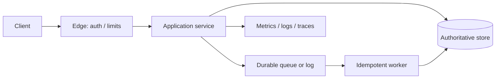

# System Architecture Design Template

Use this template for substantial design requests. Remove irrelevant headings and mark unknowns; do not fabricate answers.

## 1. Executive design

State the recommended architecture in a short paragraph. Name the main rationale and the most important trade-off.

## 2. Requirements and assumptions

### Functional requirements
- [Required behavior and explicit exclusions]

### Quality requirements
- Availability/SLO:
- Latency percentiles:
- Durability/freshness:
- RTO/RPO:
- Security/privacy/compliance:
- Cost and operational constraints:

### Assumptions and open questions
| Item | Value/assumption | Confidence | Impact if wrong |
|---|---|---|---|

## 3. Workload and sizing

| Quantity | Inputs and formula | Estimate | Unit | Confidence |
|---|---|---|---|---|
| Average/peak QPS | | | req/s | |
| Read/write split | | | % | |
| Stored data over retention | | | bytes | |
| Network/replication bandwidth | | | bytes/s or bit/s | |
| Cache footprint | | | bytes | |
| Peak concurrency | | | requests | |

Show assumptions, peak factors, overhead, safety/recovery headroom, and whether each number is measured or estimated. Avoid false precision.

## 4. Data and API contracts

Describe entities and owners, primary/secondary access patterns, invariants, transaction boundaries, data lifecycle, sensitive fields, retention/deletion, API/event schemas, idempotency, pagination, errors, authorization, and compatibility window.

## 5. High-level topology

Replace this placeholder with actual components and named data/control flows. Mark synchronous paths, asynchronous paths, trust boundaries, replicas, regions, and failure domains.

## 6. Important decisions and alternatives

| Decision | Recommended option | Alternative(s) | Why it fits | Cost/failure trade-off | Verification |
|---|---|---|---|---|---|

## 7. Correctness and failure semantics

Specify source of truth, consistency, ordering, transactions, duplicate/retry handling, stale reads, partial failure, overload, hot keys, dependency outage, data repair, migration, and user-visible degradation.

## 8. Security and privacy

List assets, actors, trust boundaries, threats, authentication, authorization, tenant isolation, secrets, encryption, sensitive data flows, abuse controls, audit, retention, deletion, and residual risk.

## 9. Reliability and operations

Define SLIs/SLOs, dashboards, actionable alerts, runbooks, rate/load shedding, rollout/rollback, backup/restore verification, disaster recovery, capacity triggers, incident ownership, and change management.

## 10. Implementation and evolution plan

Order work into safe increments. For migrations include expand/migrate/verify/contract steps, backfill, dual-read/write if needed, cutover, rollback/recovery, and success metrics.

## 11. Verification status

| Claim/requirement | Evidence or test | Result | Remaining gap |
|---|---|---|---|

Distinguish tests actually run from tests proposed. List unresolved risks, assumptions that require validation, and the next smallest useful step.
