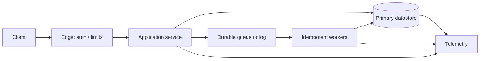

# System Architect Orchestrator

## 1. Mandate and triggers

Use for greenfield design, redesign, architecture review, scaling plans, reliability analysis, or a major technical decision. Route narrow technical questions to the relevant domain skill in this repository. Do not force a distributed architecture onto a small workload: prefer the simplest design that meets measured needs.

Use a four-phase loop: (1) scope and quantify, (2) propose a coherent high-level design and confirm its assumptions, (3) deep-dive the critical risks, (4) specify operations and evolution. Evaluate every option for reliability, scalability, and maintainability.

## 2. Intake and scope

Establish users, core use cases, functional requirements, exclusions, interfaces, data sensitivity, compliance constraints, deployment environment, budget/operational capacity, and delivery horizon. Record unknowns explicitly. Define measurable SLOs: availability, latency percentiles, durability, freshness, recovery time (RTO), and recovery point (RPO), where applicable.

Quantify workload by operation and tenant: average and peak request rate, read/write mix, payload sizes, concurrency, burst duration, geographic distribution, growth, retention, and access patterns. Separate steady-state from campaign or batch peaks. Define what correctness means for each operation (e.g., stale reads acceptable? duplicate side effects acceptable?).

## 3. Back-of-the-envelope calculations

Use consistent units and state every assumption. These are first-order estimates, not capacity guarantees.

- Average QPS = requests per day / 86,400; peak QPS = average QPS × peak factor (or derive from measured peak windows).
- Read QPS = total QPS × read fraction; write QPS = total QPS × write fraction.
- Raw storage = records/day × average stored bytes × retention days. Add indexes, replicas, metadata, compaction headroom, and backup copies separately; report both logical and physical estimates.
- Network rate (bytes/s) = operations/s × average transferred bytes. Convert to bits/s by ×8; account for protocol overhead and replication/fan-out.
- Cache footprint ≈ hot-key count × serialized value size × per-entry overhead. Estimate hit ratio using workload traces; do not infer it from cache capacity alone.
- Concurrent requests ≈ arrival rate × mean service time (Little's Law, L = λW; use matching units and note queueing assumptions).
- Availability for independent serial dependencies is approximately the product of their availabilities; independence is often false, so analyze shared failure domains.
- Replicated storage ≈ logical data × replica count, before indexes, overhead, compaction, and backups.

For latency, use measured or vendor-published values for the actual environment. Break end-to-end latency into network, queue, compute, storage and downstream budgets. Averages do not establish p95/p99/p999 behavior. Avoid universal latency-number claims without context.

## 4. Architecture selection rules

- IF a single relational database can meet workload, correctness and recovery requirements, THEN begin with it; ELSE identify the measured bottleneck before adding partitioning or specialized stores.
- IF access patterns are stable and relational constraints/transactions matter, THEN favor relational modeling; ELSE compare document, key-value, graph, search or analytical models against explicit queries.
- IF stale reads are acceptable, THEN consider asynchronous replication; ELSE define the required consistency semantics and the latency/availability cost.
- IF workload is write-heavy and sequential ingestion dominates, THEN assess LSM-based storage; ELSE if point/range reads and predictable in-place updates dominate, assess B-tree-based storage. Validate compaction, write amplification, indexes and durability for the actual engine.
- IF keys are naturally ordered and range scans dominate, THEN consider range partitioning with hot-range mitigation; ELSE hash partitioning may distribute load but loses locality.
- IF work is naturally asynchronous and retryable, THEN use durable queues/logs with idempotent consumers; ELSE use synchronous calls only when the caller needs an immediate result and its latency budget permits it.
- IF correctness spans multiple services without a practical distributed transaction, THEN model a saga/workflow with explicit compensation and idempotency; never imply compensation is rollback.
- IF operations cannot explain, test and recover the proposed system, THEN simplify or add operational capability before launch.

## 5. Construction workflow

### Phase 1 — Scope and contracts

Write functional and non-functional requirements, assumptions, invariants, API contracts, error semantics, pagination, authentication/authorization, idempotency keys, rate limits, and versioning. Define entities, ownership and lifecycle. Estimate normal and peak capacity.

### Phase 2 — Data and workload model

List queries and mutations; map each to indexes, consistency needs, transaction boundaries, retention, deletion, backup and restore. Choose storage and partition keys from access patterns, not fashion. Estimate shard skew and growth; specify online migration and rollback.

### Phase 3 — Topology and deep dive

Draw components and data/control flows, including trust boundaries, synchronous paths, asynchronous paths and failure domains. For every stateful component state source of truth, replicas, consistency, persistence, backup, recovery and ownership. Deep-dive the highest-risk bottleneck, hot key, fan-out, queue, cache invalidation and cross-service workflow.

This is a placeholder topology: replace components and flows with the actual system; do not treat it as a default stack.

### Phase 4 — Failure and operations

Analyze node/process loss, network partition, overload, dependency outage, poison messages, duplicate delivery, stale cache, hot partition, clock skew, credential compromise, bad deploy, data corruption and operator error. Define timeout, retry budget, backoff+jitter, circuit breaking, load shedding, dead-letter/replay policy, alerting, dashboards, runbooks, restore tests, rollout/rollback and capacity triggers. Distinguish at-least-once delivery from exactly-once side effects.

## 6. Required deliverable

Produce: concise requirements and assumptions; workload table with formulas; API/data contracts; topology diagram; decision matrix with alternatives and rejected options; consistency and failure semantics; capacity and scaling plan; security/privacy boundaries; observability and recovery; migration path; open questions and verification checklist. Label estimates and unknowns rather than presenting guesses as facts.

## 7. Quality gate

- [ ] Every requirement maps to a component or explicit out-of-scope statement.
- [ ] Workload values include units, peak behavior, retention and uncertainty.
- [ ] SLOs and user-visible degradation are defined.
- [ ] Data ownership, consistency, idempotency and deletion behavior are explicit.
- [ ] No single point of failure is hidden; common-cause failures are considered.
- [ ] Storage, cache and queue sizing include overhead and recovery headroom.
- [ ] Security boundaries, secrets, access control and sensitive data are addressed.
- [ ] Backups have tested restoration; migrations have rollback or recovery strategy.
- [ ] Trade-offs and assumptions are visible; system complexity is justified.
- [ ] Relevant specialist skills were consulted and implementation claims verified.
